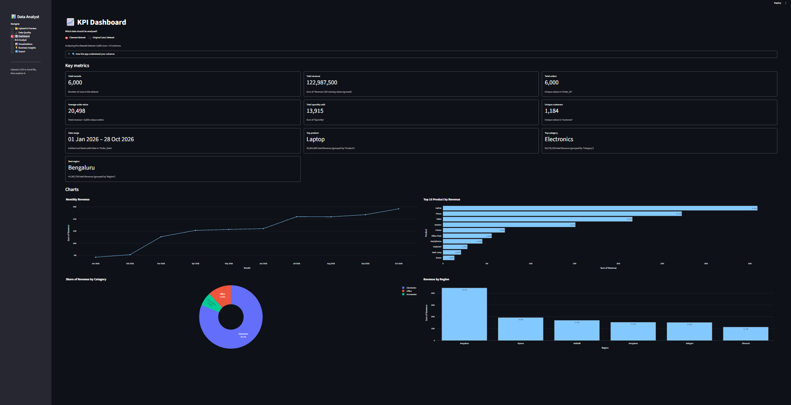
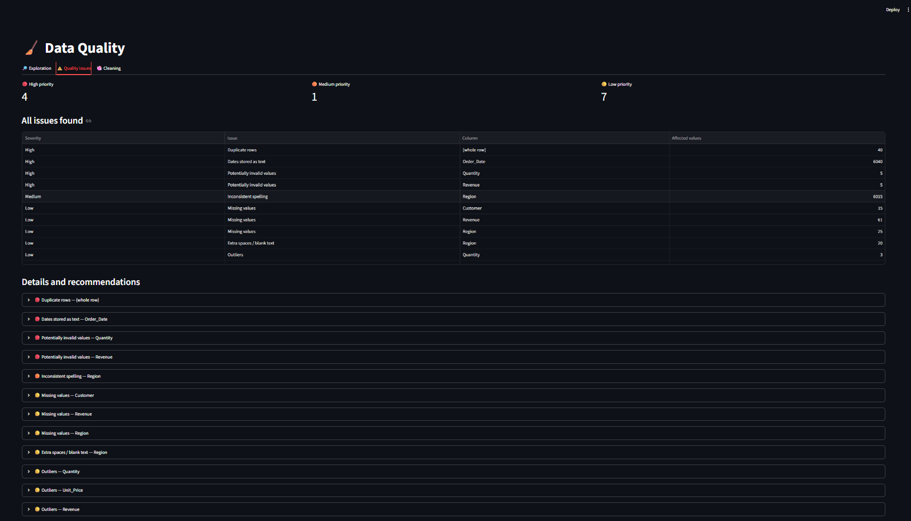
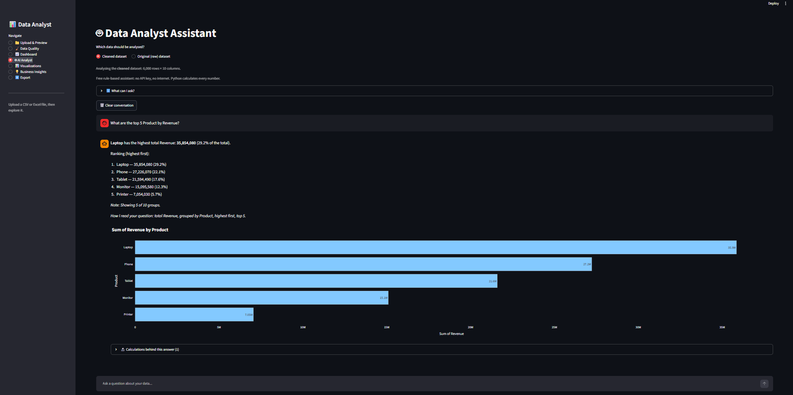
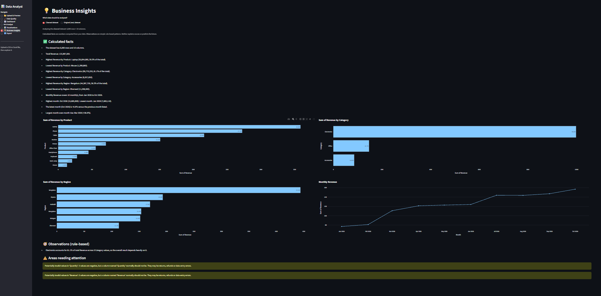

# AI-Style Data Analyst Assistant

A Streamlit web application that lets non-technical users upload a CSV or Excel dataset, check its quality, view KPI dashboards, build interactive charts, ask questions in everyday English and download reports, **without writing SQL or Python**.

> **How the "AI" works:** questions are interpreted by a rule-based natural-language parser (no external AI model and no API key). Every answer is calculated by Pandas through a validated calculation engine, so the app cannot invent numbers. An optional LLM mode is listed under Future improvements.

## Problem statement

Business users hold sales and operations data in spreadsheets but depend on analysts for simple questions such as "Which region performed best?". Spreadsheets also hide data-quality problems (duplicates, blanks, inconsistent spelling) that quietly distort totals. This project lets users explore their own data safely and see exactly how every number was calculated.

## Features

| Feature | What it does |
|---|---|
| Dataset upload | CSV and Excel (.xlsx), worksheet selection, validation with friendly errors, size and row limits |
| Data preview and exploration | Rows, columns, data types, missing values, duplicates, statistics, unique values |
| Automatic data quality checks | Missing values, duplicates, numbers/dates stored as text, extra spaces, inconsistent spelling, negative values, outliers (IQR) |
| Optional cleaning | User chooses the fixes; raw and cleaned data are kept separate |
| KPI dashboard | Detects columns by name and type; shows only metrics that can be calculated reliably and explains what is missing |
| Interactive charts | Bar, line (monthly), pie, histogram and scatter charts with Plotly; "data behind this chart" tables |
| Question-and-answer assistant | Totals, averages, counts, top/bottom N, monthly trends, filters, follow-up questions, with the calculation shown |
| Business insights | Calculated facts, rule-based observations and areas needing attention, kept separate |
| Report export | Cleaned data, KPI summary, analysis results (Excel), full insights report (Excel), Markdown report |

## Technologies used

Python, Pandas, NumPy, Streamlit, Plotly, OpenPyXL, pytest, Git and GitHub.

## Architecture

```
Upload -> file_handler -> raw DataFrame (never modified)
                              |
         data_cleaning -> cleaned DataFrame (separate copy)
                              |
   kpi / visualizations / insights / rule_assistant --> pages in app.py
                              |
                  analysis_engine (validated operations)
                              |
                       report_export --> downloads
```

```
ai_data_analyst/
|-- app.py                   Streamlit pages and navigation
|-- requirements.txt
|-- pytest.ini
|-- data/                    sample and test datasets
|-- scripts/
|   `-- generate_sample_data.py
|-- src/
|   |-- config.py            settings and limits
|   |-- file_handler.py      upload validation and loading
|   |-- data_exploration.py  dataset description
|   |-- data_cleaning.py     quality checks and cleaning
|   |-- kpi.py               column detection, KPIs, group and trend calculations
|   |-- visualizations.py    Plotly charts
|   |-- analysis_engine.py   safe, validated operations and filters
|   |-- rule_assistant.py    question parser and answer templates
|   |-- insights.py          facts, observations, attention items
|   `-- report_export.py     CSV, Excel and Markdown exports
`-- tests/                   automated tests
```

**Safety design:** the assistant never runs generated code. It can only request three whitelisted operations (`calculate_metric`, `group_and_aggregate`, `monthly_trend`). Every column name, calculation and filter is validated, and bad requests raise clear errors. There is no `eval()` or `exec()` anywhere.

## Installation

Requires Python 3.12 and Git.

```powershell
git clone https://github.com/YOUR-USERNAME/ai-data-analyst-assistant.git
cd ai-data-analyst-assistant
python -m venv venv
.\venv\Scripts\Activate.ps1
pip install -r requirements.txt
```

## Run the application

```powershell
streamlit run app.py
```

The app opens at http://localhost:8501. Upload `data/sample_sales.csv` to try it. To regenerate the sample data: `python scripts\generate_sample_data.py`.

## API key configuration

**Not needed.** The assistant is rule-based and works offline. (If an optional LLM mode is added later, the key would be stored in a git-ignored `.env` file and never in the code.)

## Run the tests

```powershell
pytest -v
```

The tests cover KPI calculations against hand-calculated values, data-quality detection, cleaning, upload validation, the safe engine (including rejection of malicious requests), export safety, and a grounding test that checks every number in an assistant answer exists in a calculated table.

## Sample questions

- What is the total revenue?
- Which product generated the highest sales?
- Top 5 products by revenue
- Which region performed best? / And which was the worst?
- Which category has the lowest sales?
- Show monthly revenue trend
- Show monthly revenue for Bengaluru
- Total revenue in February
- What is the average revenue per order?
- How many customers are there?
- Give me a summary of this dataset

The assistant declines questions it cannot answer honestly: predictions, causes ("why"), and columns that do not exist (for example profit without a cost column).

## Screenshots

| Dashboard | Data quality |
|---|---|
|  |  |

| Assistant | Business insights |
|---|---|
|  |  |

## Limitations

- The assistant understands only the question patterns coded in its rules; rephrasing may be needed. The line "How I read your question" shows how it was interpreted.
- It cannot combine columns (for example profit = revenue - cost) or join datasets.
- Insights are descriptive: they do not explain causes or forecast.
- Trends are monthly only.

## Future improvements

- Optional LLM mode (local model with Ollama or a hosted API) that only translates questions into the same validated operations.
- Calculated columns (profit, margin) and weekly or quarterly trends.
- Saving cleaning recipes, caching for very large files, and user logins.
- Deployment on Streamlit Community Cloud.